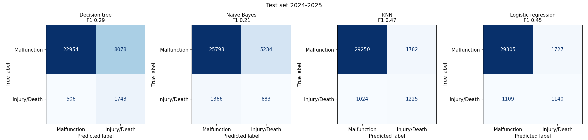
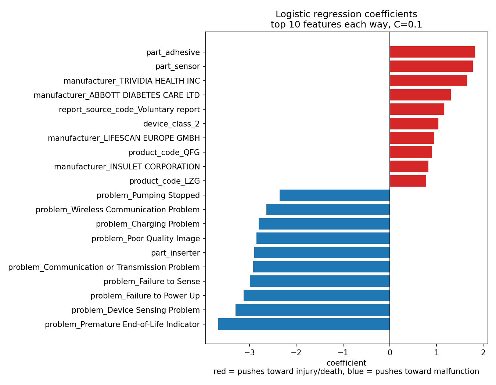
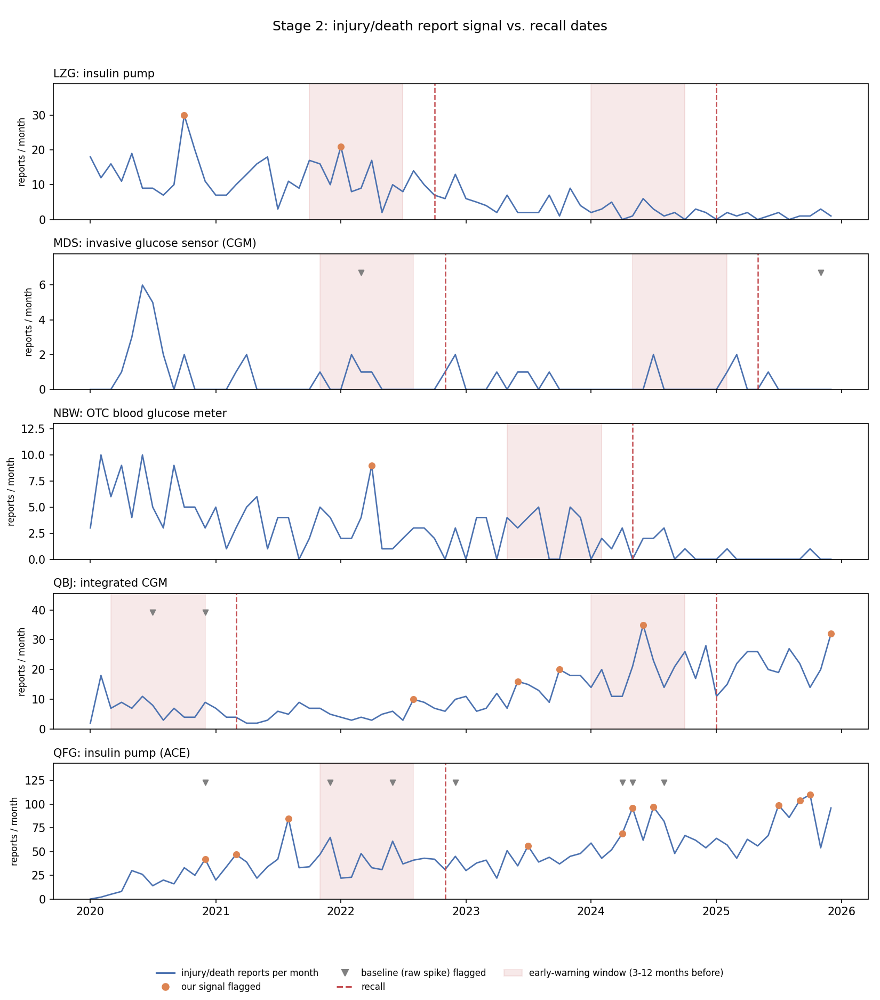

# Flagging Serious Medical Device Harm from FDA Adverse Event Reports

**Presentation video:** _link coming soon_

## How to build and run

Requires Python 3.9+ and `make`. Tested on macOS and Linux; the GitHub Actions run uses Python 3.11 on Ubuntu. On Windows, use WSL.

```bash
git clone https://github.com/ahmedhaidar13/506-project.git
cd 506-project
make install      # creates .venv and installs requirements.txt
```

**1. Get the data** (only needed once, can take a while):

Get a free openFDA API key from https://open.fda.gov/apis/authentication/ and put it in a file called `.env` in the repo root:

```
OPENFDA_API_KEY=your_key_here
```

Then run:

```bash
make data         # downloads ~100k sampled adverse event reports plus recalls, 510(k)s and device classifications into data/raw/
```

**2. Reproduce all results:**

```bash
make all          # clean -> charts -> Stage 1 models -> Stage 2 backtest
```

Or run one stage at a time:

| Command | What it does | Outputs |
|---|---|---|
| `make process` | Dedupes, standardizes dates, builds the label and features | `data/processed/events_clean.csv` |
| `make charts` | Class balance and per-feature injury/death rates | `figures/class_balance.png`, `figures/findings_*.png` |
| `make model` | Stage 1: decision tree, Naive Bayes / KNN / logistic regression comparison, K-Means on descriptions (all devices, then pumps only) | `figures/tree_*.png`, `figures/model_comparison.png`, `figures/logreg_coefficients.png`, `figures/kmeans_clusters.png` |
| `make stage2` | Stage 2: injury/death spike signal vs. FDA recall dates | `data/processed/stage2_results.csv`, `figures/stage2_timeline.png` |

`make clean` deletes `.venv` and `data/processed/` (raw downloads are kept) so you can rebuild from scratch.

Run `make help` to list every command.

## Testing

```bash
make test
```

The tests in `tests/` use small made-up data, so they don't need `data/`. They check the 2020-23 / 2024-25 time split, that train and test features line up without leaking the label, the Stage 2 spike detector, and the 12-month new-recall rule. GitHub Actions (`.github/workflows/tests.yml`) runs them on every push and pull request.

## Contributing

1. Make a branch off `main`: `git checkout -b your-feature`
2. Make your changes and run `make test`
3. Push and open a pull request; the tests must pass before merging

## Results so far

### Stage 1: flagging injury/death reports

We train on 2020-2023 and test on 2024-2025. The classifiers use only structured fields (device, user, setting, parts, and product problems). The event description text is used only for K-Means clustering, so it can't hand the classifiers the answer. We also removed two catch-all problem codes ("Adverse Event Without Identified Device or Use Problem" and "Insufficient Device Problem Information") after they dominated the decision tree's feature importance, since they were close to restating the label.

Injury/death is 6.8% of the test reports (11.3% for pumps only). The baseline always predicts injury/death, which gives an F1 of 2p/(1+p). Our goal is to beat that by at least 0.15.

**All devices** (33,281 test reports, baseline F1 0.127, goal 0.277)

| Model | Precision | Recall | Injury/death F1 | Beats baseline by |
|---|---|---|---|---|
| KNN | 0.41 | 0.54 | **0.47** | 0.34 |
| Logistic regression | 0.40 | 0.51 | **0.45** | 0.32 |
| Decision tree | 0.18 | 0.78 | 0.29 | 0.16 |
| Naive Bayes | 0.14 | 0.39 | 0.21 | 0.08 |

**Insulin pumps only** (15,347 test reports, baseline F1 0.203, goal 0.353)

| Model | Precision | Recall | Injury/death F1 | Beats baseline by |
|---|---|---|---|---|
| KNN | 0.56 | 0.58 | **0.57** | 0.36 |
| Logistic regression | 0.54 | 0.52 | **0.53** | 0.33 |
| Naive Bayes | 0.29 | 0.59 | 0.39 | 0.18 |
| Decision tree | 0.26 | 0.74 | 0.38 | 0.18 |

KNN and logistic regression clear the goal on both sets. For KNN, Naive Bayes, and logistic regression, the settings (k, C) and the probability cutoff are picked on 2023 as a validation year, then the model is refit on all of 2020-2023. The decision tree uses a fixed depth of 6 and the default cutoff, which is part of why it trades precision for recall.





One thing to keep in mind: the injury/death share rises from about 4% in 2020-2023 to about 7% in 2024-2025, so cutoffs picked on 2023 are tuned for a lower rate than the test years have.

### Stage 2: early warning before recalls (secondary)

Stage 2 did not meet its target. After the 12-month new-recall rule, 7 recalls were left to test against. Our injury/death spike signal flagged 2 of them (29%) 3-12 months early, with a median lead of 8 months. The raw report-spike baseline also flagged 2 of 7 (29%), with a median lead of 6.5 months, and it raised fewer false flags (0.18 per device-year compared with our 0.51). The goal was at least 50% and beating the baseline. There are few recalls in 2020-2025 for these device types, and report counts also move with how widely a device is used, so we treat this as a limitation instead of a main result.



---

## Project Description:
When a medical device such as an insulin pump or glucose monitor has a problem, it may get reported to the FDA. The FDA makes millions of these device reports publicly accessible through its MAUDE database, which includes some info on the devices as well as a description of the event that occurred. Because there are far too many reports to review manually, reports where a patient was seriously hurt sit in the same pile as reports of minor glitches, so serious cases can go unnoticed. Our project will address this issue by building a classification model that uses info from each report to identify whether it involved an injury or death instead of just a malfunction, which makes it so that serious reports can be prioritized for review.

## Our Goals:
Stage 1: We would first create a model that receives as input a device report and classifies it into being either an injury/death case or a malfunction case. Our model would be using features such as device class/type, device manufacturer, report source, device operator, problems with the product, and event description text trends. In order to not leak information about our label, we would be removing some of the features: the event type (label), adverse flag event, and patient outcome/patient problem. Malfunction cases significantly outweigh the number of injury/death cases, meaning that our baseline F1 score for injury/death classification would be 0. Instead, our baseline will always predict injury/death, which gives an F1 of about 2p/(1+p), where p is the share of injury/death reports in the test set. A successful model would beat this baseline's injury/death F1 by at least 0.15 on the 2024 - 2025 test set.

Stage 2 (secondary goal): we’ll use serious safety reports to look for early warning signs that a device might be heading towards a recall. For each device type, we’ll track how these safety signals change over time and then compare them to past FDA recalls to see whether the warning signs appeared early on. Furthermore, we'll measure the median number of months of warning we would've gotten, and what percentage of devices that were recalled would have been flagged early. We’ll compare our approach to a baseline that flags a device type whenever its raw monthly report count spikes. Stage 2 is successful if our signal flags at least 50% of recalls at least 3 months before the recall date and also beats this baseline. To avoid counting repeated recalls of the same device as separate events, we’ll only treat a recall as new if there weren't any recalls for that device within the last 12 months.

## Timeline:
Week 1 (Sep 28 - Oct 3): Proposal and repo setup
Submit this proposal as our README.md and submit the repo URL. Get the openFDA API key. Set up the repo structure, Makefile, requirements.txt, and basic GitHub actions now so our workflow is smoother throughout the semester.

Week 2 (Oct 5 - Oct 11): Data collection
We’ll write scripts to pull insulin pump and glucose monitor data from 2020-2025. We get the adverse event reports by downloading from the openFDA because the API limits how far you can page through results. The recalls, 510(k)s, and device classification will come from the API. We'll also count recalls per device type right away to make sure there are enough for Stage 2.

Week 3 (Oct 12 - Oct 18): Sampling, cleaning, and some initial analysis
Sample 100,000 records and balance across years, including the 2024-2025 years for testing. Clean by removing duplicates, handling missing fields, standardizing dates, and organizing descriptions of the events. Combine the data based on product codes and calculate monthly report counts for each device by type for stage 2. Generate an initial chart to explore injury/deaths vs. malfunction report counts to understand the class imbalance. Set the train/test split: 2020 - 2023 for training and 2024 - 2025 for testing

Week 4 (Oct 19 - Oct 25): Baseline model and October check in
Generate the always-injury/death baseline and decision tree. The October check in will include the data collection complete, some cleaning in progress, initial charts created, and baseline generated for comparison to our models.

Week 5 (Oct 26 - Nov 1): Add more stage 1 models
Include naive bayes and KNN. Also, generate text feature data from the descriptions. Generate initial confusion matrices.

Week 6 (Nov 2 - Nov 8): Stage 2 recall backtest
For each medical device group, create a harm signal per month according to the actual label of injury/death, and not the predicted one as predicting in train years is not a fair assessment. Cross the harm signals against the recall dates using our 12-month rule of repeat recalls. Evaluate median lead time, the share of recalls flagged early, and false flags per device-year, compared to the report-spike baseline.

Week 7 (Nov 9 - Nov 15): Clustering & visualizing the results
Use the K-Means algorithm to detect clusters in the reports. Finalize F1 score vs. baseline for Stage 1 on the test set; backtesting of Stage 2. Create time series chart of our signals versus actual recall dates; also feature importance plots.

Week 8 (Nov 16 - Nov 22): Adding logistic regression and November check in
Add logistic regression for the comparison in Stage 1. Visuals, cleaning and results of the check in.

Week 9 (Nov 30 - Dec 6): Final write up
Confirm the numbers for both stages. Write the limitations section: reports are voluntary and not verified; the number of reports partially depends on popularity of the device; the trend for some of the devices can increase even without recall. Prepare the README as final report and record a video, put the link in the beginning of README.

Dec 7 - 9: Final check and submit
Make sure the Makefile and GitHub actions workflow are good to go, then submit.
Fallback plan: If we find in Week 2 that there aren't enough recalls for insulin pumps and glucose monitors to properly test Stage 2, we'll either add another device category or drop Stage 2 and focus only on Stage 1. If the description text turns out too messy to help, we'll build Stage 1 using just the structured fields for a single device category, which still covers every required part of the project.

## Data Collection Plan: (2020 - 2025)
We'll use Python scripts to pull the recall, 510(k), and device classification data from the openFDA API using a free API key, 1,000 records at a time and filtering for only the fields we need. For the adverse event reports, we'll use openFDA's bulk download files, since the API limits how far you can page through results. We’ll mainly focus on insulin pumps and glucose monitors, while using a random sample of about 100,000 reports for Stage 1 and monthly report counts per device type in Stage 2. The datasets are joined on a product code.

Adverse event reports: https://open.fda.gov/apis/device/event/

Recall enforcement reports: https://open.fda.gov/apis/device/recall/

510(k) clearances: https://open.fda.gov/apis/device/510k/

Device classification: https://open.fda.gov/apis/device/classification/

## Modeling Plan:
Stage 1: we’ll be using decision trees, KNN + Naive Bayes, and logistic regression once covered in class. We’ll also cluster reports using K-means to find common failure types. 

Stage 2: a rolling monthly signal per device type that flags spikes in actual injury/death reports (using the real labels, not our model's predictions).

## Visualization plan:
We will use bar charts to show injury/death versus malfunction reports, confusion matrices to evaluate model performance, and feature importance plots to identify the most useful predictors. For Stage 2, we will use time-series plots to show changes in serious reports over time and compare safety signals with FDA recall dates. 

## Test plan:
Train on 2020-2023, test on 2024-2025. Report injury/death F1 for Stage 1, and median lead time, % of recalls caught early, and false flags per device-year for Stage 2, each compared to its baseline.
